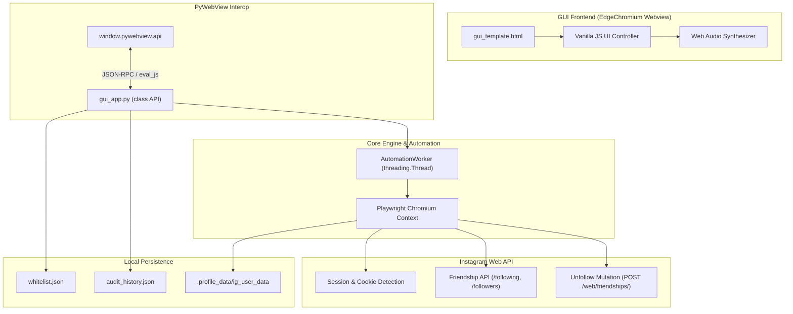
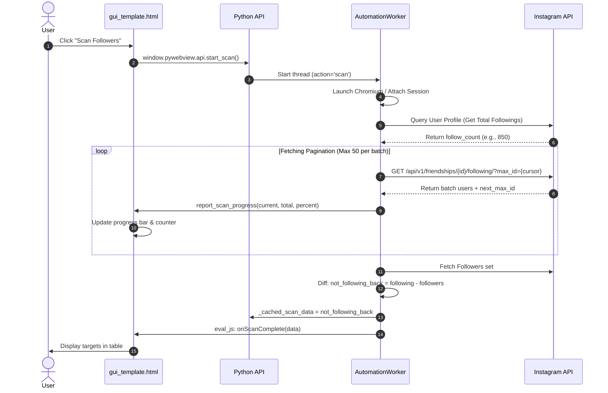
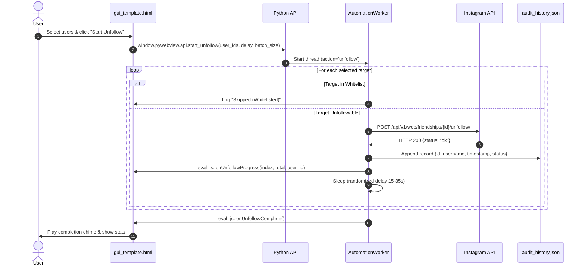

# Architecture: UnfollowX PRO

This document outlines the architecture, data structures, communication protocols, and execution workflows of **UnfollowX PRO**.

---

## 1. High-Level Architecture

UnfollowX PRO combines a modern lightweight desktop HTML5/CSS3 interface with a Python automation engine controlling a Chromium instance via Playwright.



---

## 2. Component Breakdown

### 2.1 PyWebView Host (`gui_app.py`)
- **Engine**: Microsoft Edge WebView2 (via `pythonnet` / WinForms) or MSHTML fallback.
- **Window Specs**: Default dimensions 980×680px, minimum 800×560px, centered on launch.
- **Always-on-Top Control**: Directly interfaces with Win32 `user32.dll` via `ctypes.windll.user32.SetWindowPos` to avoid WinForms thread synchronization exceptions.
- **RPC Exposure**: `class API` acts as the single boundary between JavaScript and Python.
  - Public methods: `open_login()`, `start_scan()`, `stop_scan()`, `start_unfollow()`, `stop_unfollow()`, `toggle_always_on_top()`, `get_whitelist()`, `add_whitelist()`, `remove_whitelist()`, `get_audit_history()`, `clear_audit_history()`.
  - Internal attributes: Prefixed with `_` to prevent PyWebView `get_functions` from traversing into `.NET` / `threading` objects.

### 2.2 Playwright Automation Engine (`AutomationWorker`)
- **Execution Mode**: Runs in a dedicated background daemon thread.
- **User Data Directory**: `.profile_data/ig_user_data` ensures persistent login sessions across restarts without requiring credential entry.
- **Stealth Configurations**:
  - `navigator.webdriver` set to `undefined`.
  - Realistic User-Agent: Chrome 122+ Windows desktop.
  - Natural viewport: 1280×800.
  - Randomized click delays and mouse trajectory simulation.

---

## 3. Communication & Workflows

### 3.1 Scanning Workflow with Real-Time Progress



### 3.2 Unfollow Execution Engine



---

## 4. Local Storage Schemas

### 4.1 Whitelist (`whitelist.json`)
Stores accounts protected from automated unfollowing.
```json
[
  {
    "pk": "123456789",
    "username": "zirconx_official",
    "full_name": "ZirconX",
    "profile_pic_url": "https://...",
    "added_at": "2026-10-24T20:00:00Z"
  }
]
```

### 4.2 Audit Log (`audit_history.json`)
Maintains an immutable record of all unfollow operations.
```json
[
  {
    "pk": "987654321",
    "username": "spam_account_99",
    "timestamp": "2026-10-24T21:45:12Z",
    "status": "success",
    "error": null
  }
]
```
