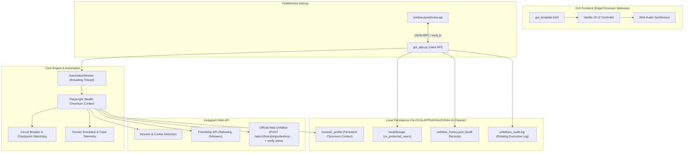
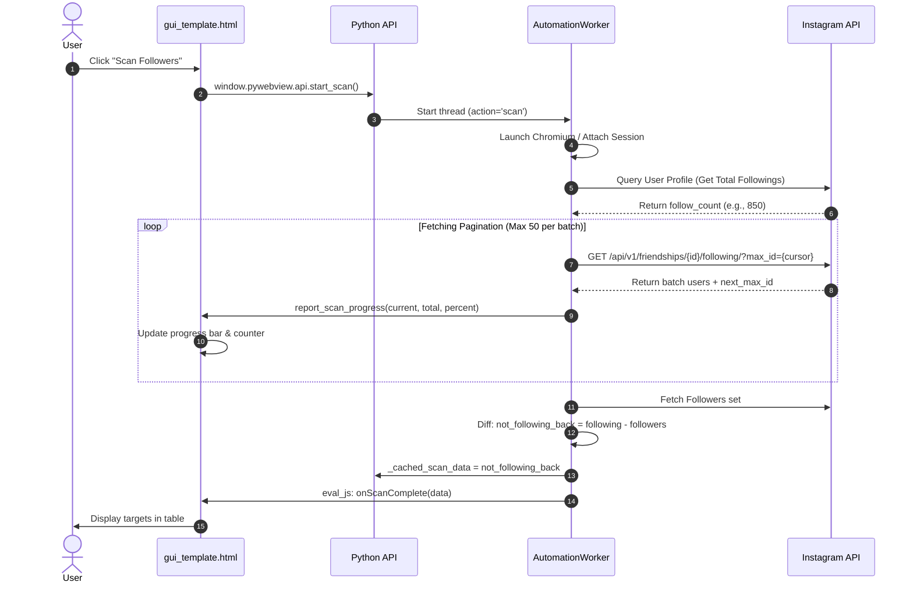
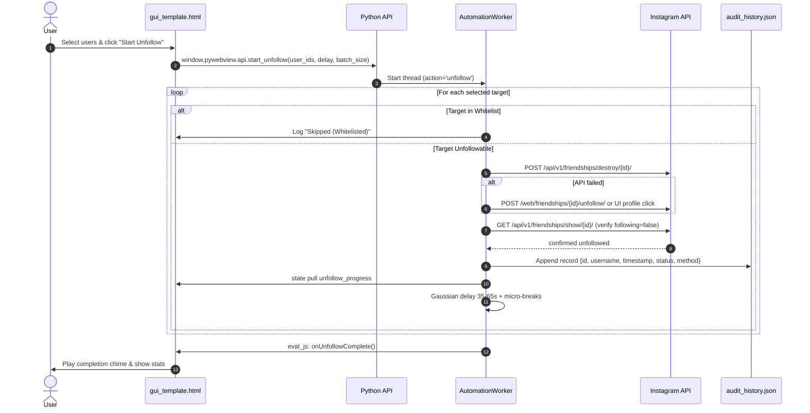

# Architecture: UnfollowX PRO

This document outlines the architecture, data structures, communication protocols, and execution workflows of **UnfollowX PRO**.

---

## 1. High-Level Architecture

UnfollowX PRO combines a modern lightweight desktop HTML5/CSS3 interface with a Python automation engine controlling a Chromium instance via Playwright.



---

## 2. Component Breakdown

### 2.1 PyWebView Host (`gui_app.py`)
- **Engine**: Microsoft Edge WebView2 (via `pythonnet` / WinForms) or MSHTML fallback.
- **Window Specs**: Default dimensions 980×640px, minimum 780×520px, centered on launch.
- **UI Flow (v0.0.6+)**: Guided 3-step rail — Login → Scan → Clean. Sidebar shows hero non-follower count + 24h quota meter; main pane shows gate screens or the account list.
- **Always-on-Top Control**: Directly interfaces with Win32 `user32.dll` via `ctypes.windll.user32.SetWindowPos` to avoid WinForms thread synchronization exceptions.
- **RPC Exposure**: `class API` acts as the single boundary between JavaScript and Python.
  - Public methods: `open_browser_window()`, `request_scan()`, `request_unfollow_batch()`, `stop_unfollow()`, `toggle_always_on_top()`, `get_app_state()`, `get_queue_list()`, `clear_queue()`, `resume_pending_queue()`, `set_warmup_mode()`, `open_profile_in_browser()`, `manual_add_targets()`, `get_history()`, `clear_history()`, `open_log_folder()`, `export_data()`.
  - Internal attributes: Prefixed with `_` to prevent PyWebView `get_functions` from traversing into `.NET` / `threading` objects.

### 2.2 Playwright Automation Engine (`BrowserWorker`)
- **Execution Mode**: Dedicated background daemon thread receiving async task closures through a thread-safe Queue.
- **User Data Directory**: `%LOCALAPPDATA%\ZXD44-IG-Cleaner\browser_profile` preserves authenticated Instagram sessions permanently.
- **Stealth Configurations**:
  - `navigator.webdriver` masked to `undefined`.
  - Realistic User-Agent: Chrome on Windows desktop.
  - Simulated human scrolling impressions and Gaussian timing delays.

### 2.3 SQLite Storage & Persistent Queue (`storage_manager.py`)
- **Database**: `%LOCALAPPDATA%\ZXD44-IG-Cleaner\unfollowx.db`
- **Tables**:
  - `unfollow_queue`: Persistent target queue with attempt counters and failure states.
  - `unfollow_history`: Immutable action log recording target ID, username, method (`friendships_destroy`, `web_friendships_unfollow`, `ui_profile`), and timestamps.
  - `scan_snapshots`: Follower and following lists for diff tracking across sessions.
  - `safety_metrics`: Rolling cooldown and trust score values.

### 2.4 Safety Engine & Trust Scoring (`safety_engine.py`)
- Evaluates threat severity across HTTP responses (401, 403, 429, 302, `checkpoint_required`, `spam: true`).
- Dynamically throttles daily quotas based on account warmup state (Warmup: 15/day, Normal: 50/day).
- Enforces exponential backoff and mandatory cooldown timers.

### 2.5 Cooldown Watcher Daemon (`watch_cooldown.py`)
- Runs as a lightweight standalone background watcher.
- Probes `/api/v1/friendships/{id}/following/?count=12` every 10 minutes without invasive load.
- When Instagram clears the 302/spam cooldown: runs a complete diff scan, writes `NON_FOLLOWERS_FOUND.txt` to Desktop and Workspace, and fires a Windows toast notification.

---

## 3. Communication & Workflows

### 3.1 Scanning Workflow with Real-Time Progress



### 3.2 Unfollow Execution Engine



---

## 4. Local Storage Schemas

### 4.1 Whitelist (`whitelist.json`)
Stores accounts protected from automated unfollowing.
```json
[
  {
    "pk": "123456789",
    "username": "zirconx_official",
    "full_name": "ZirconX",
    "profile_pic_url": "https://...",
    "added_at": "2026-10-24T20:00:00Z"
  }
]
```

### 4.2 Audit Log (`audit_history.json`)
Maintains an immutable record of all unfollow operations.
```json
[
  {
    "pk": "987654321",
    "username": "spam_account_99",
    "timestamp": "2026-10-24T21:45:12Z",
    "status": "success",
    "error": null
  }
]
```

---

## 5. Scripts & Automation Directory (`scripts/`)

| Script | Purpose |
|---|---|
| `scripts/watch_cooldown.py` | Standalone background watcher probing Instagram friendship cooldown every 90s. When clear, auto-diffs Following vs Followers, writes `NON_FOLLOWERS_FOUND.txt` to Desktop/Workspace, and triggers Windows Toast Notification. |
| `scripts/instant_diff.py` | Instant diff tool for Instagram Data Export ZIP/JSON (`following.json` vs `followers_1.json`). Bypasses all web/API rate limits in 0.01s. |
| `scripts/check_candidates.py` | Direct profile verification checker testing if candidates are followed and follow back. |
| `scripts/set_version.py` | Single Source of Truth version bump & PyInstaller build orchestrator. |

