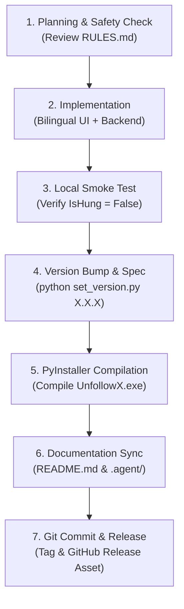

# Developer & Agent Workflows: UnfollowX PRO

This document establishes the official standard operating procedures (SOPs), workflows, and authoring guidelines for developers and AI agents contributing to **UnfollowX PRO**.

---

## 1. End-to-End Development Lifecycle



---

## 2. Standard Operating Procedures (SOPs)

### SOP 1: Adding a New Backend RPC Method

When exposing a new Python method to JavaScript via PyWebView:

1. **Safety Inspection**:
   - Check [RULES.md](file:///C:/Users/ZirconX/Desktop/Ads%20Dis/ZirconX-IG-Cleaner-Pro-v3.0/.agent/RULES.md) Section 1.
   - **MANDATORY**: Any internal attribute, helper function, or non-RPC object on `class API` **MUST** begin with an underscore `_` (e.g. `_worker`, `_window`, `_cache`).
   - Never expose an attribute returning a WinForms object, or PyWebView will enter infinite recursion and freeze Windows.
2. **Implementation in `gui_app.py`**:
   ```python
   def my_new_feature(self, param1, param2):
       """Clear docstring describing RPC purpose."""
       try:
           # Perform non-blocking logic or dispatch to worker thread
           result = self._worker.do_something(param1, param2)
           return {"success": True, "data": result}
       except Exception as e:
           return {"success": False, "error": str(e)}
   ```
3. **Frontend Integration in `gui_template.html`**:
   - Wrap RPC calls in `try/catch`.
   - Never block the UI thread waiting for responses.
   - Call via `await window.pywebview.api.my_new_feature(...)`.

---

### SOP 2: Modifying UI or Adding Visual Elements

1. **Impeccable Style Standards**:
   - Theme: Obsidian Dark palette (`#080a0f`, `#10141f`, `#161c2c`, `#1f273d`).
   - Density: Compact mini layout (Header ≤ 38px, Rows ≤ 34px, Buttons ≤ 26px).
   - Zero external CDNs: All CSS, SVGs, and audio synthesizers must run 100% offline.
2. **Bilingual Requirement (MANDATORY)**:
   - When adding text, add translations to **both** `th` (Primary) and `en` in the `I18N` dictionary in `gui_template.html`:
     ```javascript
     const I18N = {
       th: { myLabel: "ข้อความภาษาไทย" },
       en: { myLabel: "English Text" }
     };
     ```
   - Attach `data-i18n="myLabel"` to HTML elements or use `t("myLabel")` in JavaScript.
   - Test language switching via the `🇹🇭 TH | 🇬🇧 EN` toggle button.

---

### SOP 3: Diagnosing & Preventing "Not Responding" Freezes

If the window hangs or shows `(Not Responding)`:

1. **Root Cause Check**:
   - Run in PowerShell:
     ```powershell
     $p = Get-Process -Name UnfollowX -ErrorAction SilentlyContinue
     $p.Responding  # Must be True
     ```
   - If `False`, search `gui_app.py` for any new public attributes on `class API`. Prefix them with `_`.
2. **Cross-Thread WinForms Check**:
   - Never mutate `window.on_top` or UI elements from a background thread.
   - Use direct Win32 API calls (`ctypes.windll.user32.SetWindowPos`) for OS-level window management.
3. **Polling Deadlock Check**:
   - Frontend must use **Pull Polling** (`setInterval(pollState, 350)`), never have Python call `window.evaluate_js()` synchronously inside tight loops.

---

### SOP 4: Bumping Version & Rebuilding Executable

The project uses a single-command automation pipeline [set_version.py](file:///C:/Users/ZirconX/Desktop/Ads%20Dis/ZirconX-IG-Cleaner-Pro-v3.0/set_version.py):

```powershell
# Step 1: Bump version and compile executable automatically
python set_version.py 0.0.2 --build

# Step 2: Verify binary properties
(Get-Item ".\UnfollowX.exe").VersionInfo | Format-List ProductVersion, FileVersion, CompanyName
```

**What `set_version.py` updates automatically:**
- [version.py](file:///C:/Users/ZirconX/Desktop/Ads%20Dis/ZirconX-IG-Cleaner-Pro-v3.0/source_code/python_engine/version.py): Python version constant.
- [version_info.txt](file:///C:/Users/ZirconX/Desktop/Ads%20Dis/ZirconX-IG-Cleaner-Pro-v3.0/source_code/python_engine/version_info.txt): Windows PE metadata (FileVersion & ProductVersion).
- [HOW_TO_USE.txt](file:///C:/Users/ZirconX/Desktop/Ads%20Dis/ZirconX-IG-Cleaner-Pro-v3.0/HOW_TO_USE.txt): Header banner.
- [.agent/README.md](file:///C:/Users/ZirconX/Desktop/Ads%20Dis/ZirconX-IG-Cleaner-Pro-v3.0/.agent/README.md): Documentation header.
- Compiles via PyInstaller and deploys `UnfollowX.exe` to root.

---

### SOP 5: GitHub Release Deployment

To release a new version to [https://github.com/ZXD44/UnfollowX/releases](https://github.com/ZXD44/UnfollowX/releases):

1. **Commit and Tag**:
   ```powershell
   git add .
   git commit -m "feat: release version v0.0.2"
   git tag -a v0.0.2 -m "UnfollowX PRO v0.0.2"
   git push origin main --tags
   ```
2. **Publish Release & Upload Executable**:
   - Go to: `https://github.com/ZXD44/UnfollowX/releases/new`
   - Select Tag `v0.0.2`.
   - Title: `UnfollowX PRO v0.0.2 — [Release Highlights]`
   - Attach binary asset: Drag & drop `UnfollowX.exe` (~51 MB).
   - Write bilingual release notes using the standard template below.

---

## 3. Writing Guidelines & Standards

### 3.1 Commit Message Conventions
Follow Conventional Commits:
* `feat:` A new user-facing feature (e.g. `feat: add bilingual language toggle`)
* `fix:` A bug fix (e.g. `fix: prevent WinForms bridge recursive traversal freeze`)
* `docs:` Documentation only changes (e.g. `docs: update workflow specifications`)
* `chore:` Build scripts, version bumps, or dependency updates (e.g. `chore: bump version to 0.0.2`)
* `refactor:` Code reorganization without behavioral changes (e.g. `refactor: extract i18n engine`)

### 3.2 Author Attribution Rule
* **Author Name**: `ZXD44`
* **Author Email**: `zxd44@users.noreply.github.com`
* Never commit under unverified or generic names.

### 3.3 Release Notes Standard Template
Always format GitHub Release notes with bilingual sections:
```markdown
# 🚀 UnfollowX PRO vX.X.X — [Headline]

## 🇹🇭 สิ่งใหม่ในเวอร์ชันนี้ (Release Highlights)
* ฟีเจอร์ใหม่ 1
* ฟีเจอร์ใหม่ 2
* การปรับปรุงความปลอดภัยและการแก้ปัญหา

## 🇬🇧 English Overview
* Feature highlight 1
* Feature highlight 2
* Performance and bug fixes

## 📦 การติดตั้งและดาวน์โหลด (Downloads)
1. ดาวน์โหลดไฟล์ `UnfollowX.exe` ในส่วน Assets ด้านล่าง
2. ดับเบิลคลิกเปิดใช้งานได้ทันที (ไม่ต้องติดตั้งโปรแกรมเสริม)
```

---

## 4. Safety & Verification Checklist

Before publishing any code or building an executable, verify:

- [ ] Window responsiveness: `Get-Process UnfollowX | Select Responding` returns `True`.
- [ ] PyWebView JS Bridge: No public non-underscore attributes exposing .NET objects on `API`.
- [ ] Rate limits: Unfollow delay is at least 15-35s randomized jitter; batch cap is 15-30.
- [ ] Whitelist protection: Whitelisted accounts (`🛡️`) are strictly bypassed during automated cleanups.
- [ ] Bilingual check: All new text keys exist in both `th` and `en` dictionaries in `gui_template.html`.
- [ ] Clean repository: No temporary build files (`build/`, `dist/`, `__pycache__/`) tracked in Git.
- [ ] Standalone EXE properties: Windows File Version and Product Version match `version.py`.
