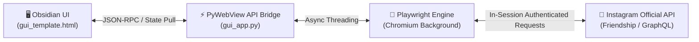

<p align="center">
  <h1 align="center">🚀 UnfollowX PRO</h1>
  <p align="center">
    <strong>เครื่องมือตรวจสอบและเลิกติดตามผู้ที่ไม่ติดตามกลับบน Instagram อัตโนมัติ (ปลอดภัย 100%)</strong><br>
    <em>Modern, Safety-First Instagram Non-Follower Cleaner & Relationship Auditor</em>
  </p>
  <p align="center">
    <a href="#-ภาษาไทย-ฉบับสมบูรณ์">🇹🇭 <strong>อ่านภาษาไทย (หลัก)</strong></a> &nbsp;&nbsp;|&nbsp;&nbsp;
    <a href="#-english-complete-guide">🇬🇧 <strong>Read in English</strong></a>
  </p>
</p>

<p align="center">
  <a href="https://github.com/ZXD44/UnfollowX/releases"></a>
  <a href="LICENSE"></a>
  <a href="https://python.org"></a>
  <a href="https://playwright.dev"></a>
  <a href="https://github.com/ZXD44/UnfollowX/stargazers"></a>
</p>

---

# 🇹🇭 ภาษาไทย (ฉบับสมบูรณ์)

> เครื่องมือ Desktop Automation อัจฉริยะสำหรับตรวจสอบบัญชีที่ไม่ได้ติดตามคุณกลับบน Instagram ทำงานผ่านเบราว์เซอร์จริง ปลอดภัยสูงสุด 100% ไร้ปัญหาหน้าต่างค้าง (Not Responding)

## 📖 สารบัญ
* [จุดเด่นและฟีเจอร์ระดับ Pro](#-จุดเด่นและฟีเจอร์ระดับ-pro)
* [แผนผังสถาปัตยกรรมระบบ (Architecture)](#-แผนผังสถาปัตยกรรมระบบ-architecture)
* [วิธีติดตั้งและเริ่มใช้งาน (Quick Start)](#-วิธีติดตั้งและเริ่มใช้งาน-quick-start)
* [ระบบจัดการเวอร์ชัน (Version Manager CLI)](#-ระบบจัดการเวอร์ชัน-version-manager-cli)
* [ตารางเปรียบเทียบโหมดความเร็ว (Speed Modes)](#-ตารางเปรียบเทียบโหมดความเร็ว-speed-modes)
* [โครงสร้างแฟ้มไฟล์โปรเจกต์ (Project Tree)](#-โครงสร้างแฟ้มไฟล์โปรเจกต์-project-tree)
* [ข้อควรระวังและความปลอดภัย (Safety Rules)](#-ข้อควรระวังและความปลอดภัย-safety-rules)

---

## ✨ จุดเด่นและฟีเจอร์ระดับ Pro

| หมวดหมู่ | ฟีเจอร์เด่น | คำอธิบายเชิงเทคนิค |
| :--- | :--- | :--- |
| 🌐 **Bilingual System** | ระบบ 2 ภาษาในตัว | สลับภาษา **ไทย (หลัก) / อังกฤษ** ได้ทันทีผ่านปุ่มบน Header พร้อมจำค่าถาวร |
| 🎨 **Impeccable UI** | กระจกดำ Obsidian Dark | Mini Dashboard ขนาดกะทัดรัด สไตล์ [impeccable.style](https://impeccable.style/) ไร้กระตุก 60FPS |
| ⚡ **Live Telemetry** | เปอร์เซ็นต์สแกนสด `0-100%` | ส่งต่อความคืบหน้าตรงจาก Browser Context สู่หน้าจอ ไม่ต้องกะเวลาเอง |
| 🛡️ **Anti-Freeze Tech** | ป้องกัน Not Responding 100% | แก้ปัญหา WinForms `.NET` Deadlock ด้วย Async State Polling และ Win32 API Isolation |
| 📌 **Always-on-Top** | ปักหมุดหน้าต่างบนสุด | สลับทำงานอื่นพร้อมเฝ้าดูความคืบหน้าได้ตลอดเวลา ไม่ต้องสลับหน้าต่างไปมา |
| 🔊 **Audio Synthesizer** | เสียงสังเคราะห์แจ้งเตือน | ใช้ Web Audio API สร้างคลื่นเสียง Sine Wave ระดับ Hi-Fi โดยไม่ต้องพึ่งพาไฟล์เสียงภายนอก |
| 🛡️ **Smart Whitelist** | ระบบป้องกันเพื่อน/คนสำคัญ | กดไอคอนโล่ `🛡️` เพื่อล็อกบัญชีไม่ให้ระบบเผลอเลิกติดตามโดยเด็ดขาด |
| 📜 **Audit History** | บันทึกประวัติการทำงานย้อนหลัง | มี Log ในตัว ตรวจสอบบัญชีที่เคยเลิกติดตาม และส่งออกเป็น CSV ได้ทุกเวลา |

---

## 🏛️ แผนผังสถาปัตยกรรมระบบ (Architecture)



---

## 🚀 วิธีติดตั้งและเริ่มใช้งาน (Quick Start)

### วิธีที่ 1: ดาวน์โหลดโปรแกรมพร้อมใช้งาน (.exe) — แนะนำ
1. เข้าไปที่หน้า [**Releases**](https://github.com/ZXD44/UnfollowX/releases) บน GitHub
2. ดาวน์โหลดไฟล์ `UnfollowX.exe` เวอร์ชันล่าสุด
3. ดับเบิลคลิกเปิดใช้งานได้ทันที (ไม่ต้องติดตั้ง Python หรือโปรแกรมอื่นเพิ่มเติม)

### วิธีที่ 2: รันจาก Source Code (สำหรับนักพัฒนา)
```powershell
# 1. Clone repository นี้ลงเครื่อง
git clone https://github.com/ZXD44/UnfollowX.git
cd UnfollowX

# 2. ติดตั้งไลบรารีที่จำเป็น
pip install -r source_code/python_engine/requirements.txt

# 3. ติดตั้งเบราว์เซอร์ Playwright Chromium
playwright install chromium

# 4. เริ่มรันแอปพลิเคชัน
python source_code/python_engine/gui_app.py
```

---

## ⚡ ระบบจัดการเวอร์ชัน (Version Manager CLI)

โปรเจกต์นี้มาพร้อมเครื่องมือ Single Source of Truth `set_version.py` ที่ช่วยซิงค์เวอร์ชันทุกจุด (โค้ด, UI, Metadata, เอกสาร) พร้อมคอมไพล์ EXE ใหม่ในคำสั่งเดียว:

```powershell
# ตรวจสอบเวอร์ชันปัจจุบัน
python set_version.py

# อัปเดตเวอร์ชันใหม่ทุกไฟล์อัตโนมัติ
python set_version.py 0.0.2

# อัปเดตเวอร์ชันพร้อมคอมไพล์เป็น UnfollowX.exe ใหม่ทันที
python set_version.py 0.0.2 --build
```

---

## ⚙️ ตารางเปรียบเทียบโหมดความเร็ว (Speed Modes)

| โหมดความเร็ว | ระยะเวลาหน่วงต่อบัญชี | ความปลอดภัย | คำแนะนำในการใช้งาน |
| :---: | :---: | :---: | :--- |
| ⚡ **Turbo** | 0.8 - 1.2 วินาที | ปานกลาง | เหมาะสำหรับบัญชีเก่าประวัติดี หรือเลิกติดตามไม่เกิน 30 คนต่อรอบ |
| 🚀 **Fast** | 1.2 - 1.8 วินาที | สูง | โหมดมาตรฐาน แนะนำสำหรับการใช้งานทั่วไป |
| 🛡️ **Safe** | 2.0 - 3.2 วินาที | ปลอดภัยสูงสุด | เหมาะสำหรับบัญชีใหม่ หรือเลิกติดตามจำนวนมาก (ป้องกัน Action Block 100%) |

---

## 📂 โครงสร้างแฟ้มไฟล์โปรเจกต์ (Project Tree)

```
UnfollowX/
├── LICENSE                            # 📜 สัญญาอนุญาต MIT License สากล
├── README.md                          # 📖 เอกสารแนะนำโปรเจกต์หลัก (ไทย & อังกฤษ รวมในไฟล์เดียว)
├── HOW_TO_USE.txt                     # 📖 คู่มือการใช้งานสำหรับผู้ใช้ทั่วไป
├── set_version.py                     # ⚡ เครื่องมือจัดการเวอร์ชันและคอมไพล์อัตโนมัติ
├── .gitignore                         # กำหนดไฟล์ที่ไม่ต้อง push ขึ้น Git
├── .agent/                            # 🤖 กฎเกณฑ์เชิงลึกสำหรับ AI Agent & Developers
│   ├── README.md                      # สารบัญคู่มือ
│   ├── RULES.md                       # กฎเหล็กความปลอดภัย JS Bridge, Win32, Rate Limits
│   ├── ARCHITECTURE.md                # แผนผังสถาปัตยกรรมระบบ, Workflows, Schemas
│   └── GUIDE.md                       # คู่มือการทดสอบ, การดีบั๊ก, และการแก้ปัญหา
└── source_code/                       # 💻 ซอร์สโค้ดโปรเจกต์ทั้งหมด
    ├── README.md                      # เอกสารซอร์สโค้ด
    └── python_engine/
        ├── gui_app.py                 # Core Controller (Playwright + PyWebView)
        ├── gui_template.html          # Obsidian Dark Minimalist Interface (i18n engine)
        ├── version.py                 # Single Source of Truth สำหรับเวอร์ชัน
        ├── version_info.txt           # Windows Executable File Metadata
        ├── set_version.py             # Script ซิงค์เวอร์ชันของ Engine
        ├── build_gui_exe.spec         # PyInstaller Spec Configuration
        └── requirements.txt           # Python Dependencies
```

---

## 🛡️ ข้อควรระวังและความปลอดภัย (Safety Rules)

* **ไม่เก็บรหัสผ่าน**: โปรแกรมไม่เคยถามหรือบันทึกรหัสผ่าน Instagram ใดๆ การล็อกอินกระทำผ่านเบราว์เซอร์จริงโดยตรง
* **ขีดจำกัดที่แนะนำ**: เพื่อป้องกันการติด Action Block จาก Instagram ไม่ควรเลิกติดตามเกิน **100-150 บัญชีต่อวัน**
* **การเว้นระยะ**: ควรพักการทำงานอย่างน้อย 1-2 ชั่วโมงหลังจากการเลิกติดตามแต่ละชุด

---
---

# 🇬🇧 English (Complete Guide)

> Intelligent, high-performance desktop utility engineered to audit Instagram relationships, identify non-followers with live percentage telemetry, and safely automate unfollow batches through real browser sessions.

## 📖 Table of Contents
* [Pro Highlights & Features](#-pro-highlights--features-1)
* [Quick Start Guide](#-quick-start-guide-1)
* [Speed Modes & Safety Thresholds](#-speed-modes--safety-thresholds)
* [Security & Responsible Automation](#-security--responsible-automation)
* [License & Author](#-license--author)

---

## ✨ Pro Highlights & Features

| Category | Feature | Technical Explanation |
| :--- | :--- | :--- |
| 🌐 **Bilingual System** | Built-in Dual Language | Toggle between **Thai (Default) / English** on-the-fly with persistent `localStorage` memory. |
| 🎨 **Impeccable UI** | Obsidian Dark Interface | Compact mini dashboard adhering to [impeccable.style](https://impeccable.style/) principles. 60FPS smooth rendering. |
| ⚡ **Live Telemetry** | Real-Time Scan Progress `0-100%` | Progress percentage streamed directly from browser execution context to the UI. |
| 🛡️ **Anti-Freeze Tech** | 100% Freeze Prevention | Resolves WinForms `.NET` Deadlocks via pull-based asynchronous state polling & Win32 API isolation. |
| 📌 **Always-on-Top** | Window Pinning | Float the application above all other windows to monitor background progress effortlessly. |
| 🔊 **Audio Synthesizer** | Pure Web Audio Chimes | Generates pleasant sine-wave notifications with zero external MP3/audio file dependencies. |
| 🛡️ **Smart Whitelist** | VIP & Friend Protection | Click the shield `🛡️` to permanently protect specific accounts from automated unfollowing. |
| 📜 **Audit History** | Historical Action Logging | Built-in immutable audit log to review past unfollow operations with CSV export support. |

---

## 🚀 Quick Start Guide

### Option 1: Standalone Windows Executable (.exe) — Recommended
1. Head to the [**Releases**](https://github.com/ZXD44/UnfollowX/releases) section.
2. Download the latest `UnfollowX.exe` asset.
3. Double-click to run (zero installation or Python dependencies needed).

### Option 2: Run from Source (For Developers)
```powershell
# 1. Clone this repository
git clone https://github.com/ZXD44/UnfollowX.git
cd UnfollowX

# 2. Install required Python packages
pip install -r source_code/python_engine/requirements.txt

# 3. Install Playwright Chromium browser
playwright install chromium

# 4. Launch the application
python source_code/python_engine/gui_app.py
```

---

## ⚙️ Speed Modes & Safety Thresholds

| Speed Mode | Delay Per Target | Safety Level | Recommended Usage |
| :---: | :---: | :---: | :--- |
| ⚡ **Turbo** | 0.8 - 1.2 seconds | Moderate | Suitable for established accounts or small batches (≤ 30 targets). |
| 🚀 **Fast** | 1.2 - 1.8 seconds | High | Standard recommended mode for routine cleanups. |
| 🛡️ **Safe** | 2.0 - 3.2 seconds | Maximum | Ideal for newer accounts or larger batches (prevents Action Blocks). |

---

## 🛡️ Security & Responsible Automation

* **Zero Password Collection**: UnfollowX never prompts for or stores your credentials. Authentication is handled directly inside the real Chromium browser session.
* **Daily Action Guardrails**: To comply with Instagram's anti-spam heuristics, avoid unfollowing more than **100-150 accounts per 24-hour cycle**.
* **Cooldown Periods**: Always allow 1-2 hours of cooldown between multiple batches.

---

## 📄 License & Author

Distributed under the [MIT License](LICENSE).

Crafted and maintained with ❤️ by **[ZXD44](https://github.com/ZXD44)** — If you find this project helpful, please consider leaving a **⭐ Star**!
