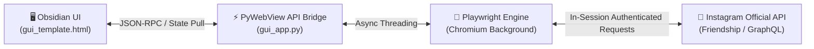

<div align="right">
  <strong>🌐 Language / ภาษา:</strong>
  <a href="README.md">🇹🇭 ภาษาไทย (หลัก)</a> |
  <a href="README_EN.md"><strong>🇬🇧 English</strong></a>
</div>

<p align="center">
  <h1 align="center">🚀 UnfollowX PRO</h1>
  <p align="center">
    <strong>Modern, Safety-First Instagram Non-Follower Cleaner & Relationship Auditor</strong><br>
    <em>Engineered with Playwright automation, real browser sessions, and zero-deadlock desktop architecture.</em>
  </p>
</p>

<p align="center">
  <a href="https://github.com/ZXD44/UnfollowX/releases"></a>
  <a href="LICENSE"></a>
  <a href="https://python.org"></a>
  <a href="https://playwright.dev"></a>
  <a href="https://github.com/ZXD44/UnfollowX/stargazers"></a>
</p>

---

## 📖 Table of Contents
* [Pro Highlights & Features](#-pro-highlights--features)
* [System Architecture](#-system-architecture)
* [Quick Start Guide](#-quick-start-guide)
* [Version Manager & Build Automation](#-version-manager--build-automation)
* [Speed Modes & Safety Matrix](#-speed-modes--safety-matrix)
* [Project Directory Structure](#-project-directory-structure)
* [Security & Account Safety](#-security--account-safety)
* [License & Author](#-license--author)

---

## ✨ Pro Highlights & Features

| Category | Feature | Technical Explanation |
| :--- | :--- | :--- |
| 🌐 **Bilingual System** | Built-in Dual Language | Toggle between **Thai (Default) / English** on-the-fly with persistent `localStorage` memory. |
| 🎨 **Impeccable UI** | Obsidian Dark Interface | Compact mini dashboard adhering to [impeccable.style](https://impeccable.style/) principles. 60FPS smooth rendering. |
| ⚡ **Live Telemetry** | Real-Time Scan Progress `0-100%` | Progress percentage streamed directly from browser execution context to the UI. |
| 🛡️ **Anti-Freeze Tech** | 100% Freeze Prevention | Resolves WinForms `.NET` Deadlocks via pull-based asynchronous state polling & Win32 API isolation. |
| 📌 **Always-on-Top** | Window Pinning | Float the application above all other windows to monitor background progress effortlessly. |
| 🔊 **Audio Synthesizer** | Pure Web Audio Chimes | Generates pleasant sine-wave notifications with zero external MP3/audio file dependencies. |
| 🛡️ **Smart Whitelist** | VIP & Friend Protection | Click the shield `🛡️` to permanently protect specific accounts from automated unfollowing. |
| 📜 **Audit History** | Historical Action Logging | Built-in immutable audit log to review past unfollow operations with CSV export support. |

---

## 🏛️ System Architecture



---

## 🚀 Quick Start Guide

### Option 1: Standalone Windows Executable (.exe) — Recommended
1. Head to the [**Releases**](https://github.com/ZXD44/UnfollowX/releases) section.
2. Download the latest `UnfollowX.exe` asset.
3. Double-click to run (zero installation or Python dependencies needed).

### Option 2: Run from Source (For Developers)
```powershell
# 1. Clone this repository
git clone https://github.com/ZXD44/UnfollowX.git
cd UnfollowX

# 2. Install required Python packages
pip install -r source_code/python_engine/requirements.txt

# 3. Install Playwright Chromium browser
playwright install chromium

# 4. Launch the application
python source_code/python_engine/gui_app.py
```

---

## ⚡ Version Manager & Build Automation

UnfollowX comes with a CLI single-source-of-truth version management script:

```powershell
# Display current version
python set_version.py

# Bump version across all files and documentation
python set_version.py 0.0.2

# Bump version AND compile new standalone UnfollowX.exe in one command
python set_version.py 0.0.2 --build
```

---

## ⚙️ Speed Modes & Safety Matrix

| Speed Mode | Delay Per Target | Safety Level | Recommended Usage |
| :---: | :---: | :---: | :--- |
| ⚡ **Turbo** | 0.8 - 1.2 seconds | Moderate | Suitable for established accounts or small batches (≤ 30 targets). |
| 🚀 **Fast** | 1.2 - 1.8 seconds | High | Standard recommended mode for routine cleanups. |
| 🛡️ **Safe** | 2.0 - 3.2 seconds | Maximum | Ideal for newer accounts or larger batches (prevents Action Blocks). |

---

## 📂 Project Directory Structure

```
UnfollowX/
├── LICENSE                            # 📜 MIT License
├── README.md                          # 📖 Thai Documentation (Default)
├── README_EN.md                       # 📖 English Documentation (This file)
├── HOW_TO_USE.txt                     # 📖 Simple bilingual user instructions
├── set_version.py                     # ⚡ Version Manager & Build CLI
├── .gitignore                         # Build and temporary files exclusion
├── .agent/                            # 🤖 In-depth agent & developer rules
│   ├── README.md                      # Index
│   ├── RULES.md                       # Critical safety rules & JS bridge boundaries
│   ├── ARCHITECTURE.md                # System diagrams & Data flows
│   └── GUIDE.md                       # Testing, building, and debugging guides
└── source_code/                       # 💻 Complete source codebase
    ├── README.md                      # Source overview
    └── python_engine/
        ├── gui_app.py                 # Core Controller (Playwright + PyWebView)
        ├── gui_template.html          # Obsidian Dark Minimalist Interface
        ├── version.py                 # Single Source of Truth for version
        ├── version_info.txt           # Windows Executable File Metadata
        ├── set_version.py             # Engine version sync script
        ├── build_gui_exe.spec         # PyInstaller Configuration
        └── requirements.txt           # Python Dependencies
```

---

## 🛡️ Security & Account Safety

* **Zero Password Collection**: UnfollowX never prompts for or stores your credentials. Authentication is handled directly inside the real Chromium browser session.
* **Daily Action Guardrails**: To comply with Instagram's anti-spam heuristics, avoid unfollowing more than **100-150 accounts per 24-hour cycle**.
* **Cooldown Periods**: Always allow 1-2 hours of cooldown between multiple batches.

---

## 📄 License & Author

Distributed under the [MIT License](LICENSE).

Crafted and maintained with ❤️ by **[ZirconX](https://github.com/ZXD44)** — If you find this project helpful, please consider leaving a **⭐ Star**!
